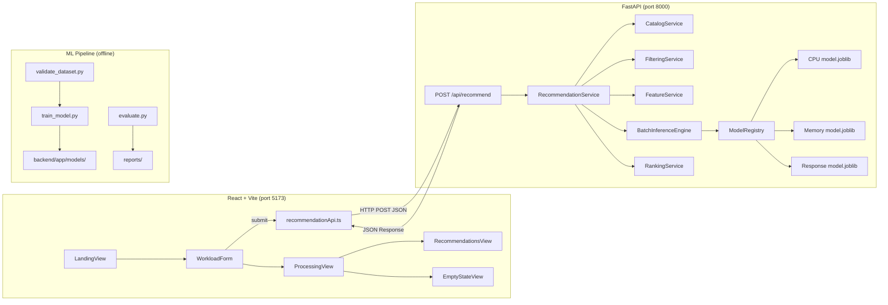
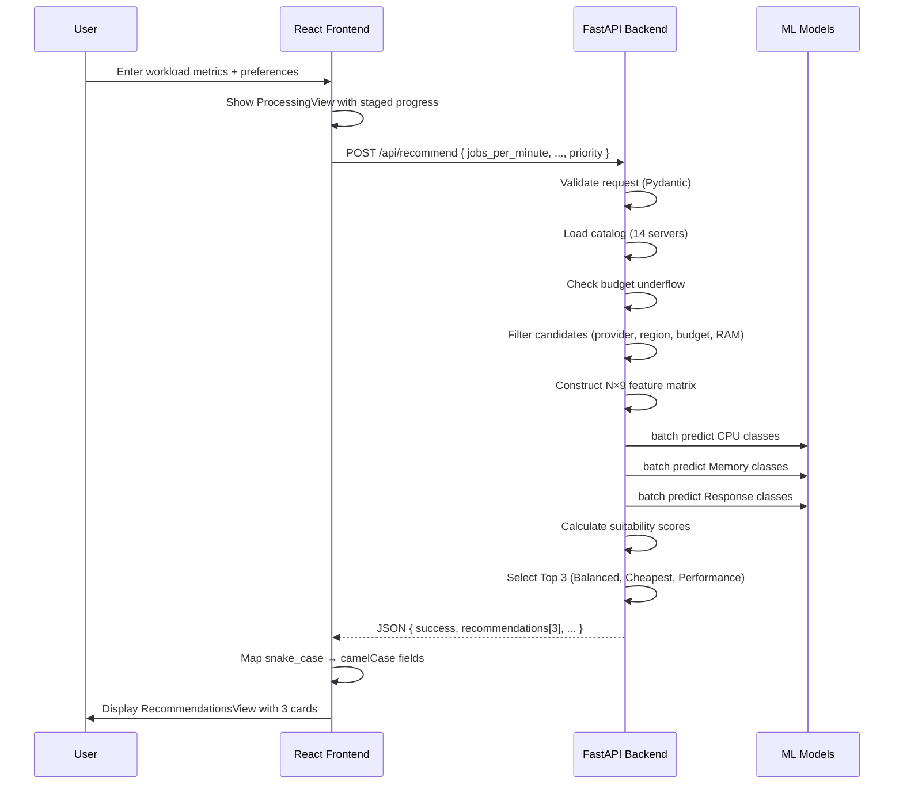

# ☁️ Cloud Server Recommendation System — Complete Codebase Analysis

## 1. Project Overview

**CloudSizer** is an AI-assisted cloud infrastructure sizing system that recommends the best AWS/Azure cloud servers for a given application workload. It combines:

- A **React 19 + TypeScript + Vite 8** frontend
- A **FastAPI + Scikit-Learn** ML backend
- **3 independent ML classification models** (CPU, Memory, Response Time)

The user enters workload metrics (jobs/min, network activity) and optional preferences (provider, budget, priority), and the system returns **Top 3 Recommendations**: Best Balanced, Cheapest Suitable, and Best Performance.

---

## 2. Architecture



---

## 3. Complete File Inventory

### Frontend (`src/`)

| File | Purpose |
|:-----|:--------|
| [`App.tsx`](file:///d:/a_code%20vs/hci_ml_proj/Hci_ml_proj/src/App.tsx) | Root component — view state machine (landing → input → processing → results/empty) |
| [`main.tsx`](file:///d:/a_code%20vs/hci_ml_proj/Hci_ml_proj/src/main.tsx) | React DOM entrypoint |
| [`types/index.ts`](file:///d:/a_code%20vs/hci_ml_proj/Hci_ml_proj/src/types/index.ts) | TypeScript interfaces: `WorkloadInput`, `RecommendResponse`, `ServerSpecification`, etc. |
| [`services/recommendationApi.ts`](file:///d:/a_code%20vs/hci_ml_proj/Hci_ml_proj/src/services/recommendationApi.ts) | API client — calls `POST /api/recommend`, with mock fallback |
| [`data/mockServers.ts`](file:///d:/a_code%20vs/hci_ml_proj/Hci_ml_proj/src/data/mockServers.ts) | 14-server mock catalog (mirrors backend catalog) |
| `components/layout/` | `AppHeader`, `StepIndicator` |
| `components/screens/` | `LandingView`, `WorkloadForm`, `ProcessingView`, `RecommendationsView`, `EmptyStateView`, `RecommendationCard`, `ServerDetailsModal`, `ComparisonModal`, `WorkloadSidePanel` |
| `components/common/` | `FieldTooltip`, `NumberInput` |
| `tokens.css`, `index.css`, `App.css` | Design system tokens and global styles |

### Backend (`backend/app/`)

| File | Purpose |
|:-----|:--------|
| [`main.py`](file:///d:/a_code%20vs/hci_ml_proj/Hci_ml_proj/backend/app/main.py) | FastAPI app entrypoint — startup lifecycle, CORS, exception handlers, router includes |
| [`core/config.py`](file:///d:/a_code%20vs/hci_ml_proj/Hci_ml_proj/backend/app/core/config.py) | Settings class (paths, CORS origins, API prefix) |
| [`core/logging.py`](file:///d:/a_code%20vs/hci_ml_proj/Hci_ml_proj/backend/app/core/logging.py) | Structured logger setup |
| [`api/routes/recommendations.py`](file:///d:/a_code%20vs/hci_ml_proj/Hci_ml_proj/backend/app/api/routes/recommendations.py) | `POST /api/recommend` endpoint |
| [`api/routes/catalog.py`](file:///d:/a_code%20vs/hci_ml_proj/Hci_ml_proj/backend/app/api/routes/catalog.py) | `GET /api/catalog`, `GET /api/catalog/{id}` |
| [`api/routes/health.py`](file:///d:/a_code%20vs/hci_ml_proj/Hci_ml_proj/backend/app/api/routes/health.py) | `GET /health` |
| [`api/routes/models.py`](file:///d:/a_code%20vs/hci_ml_proj/Hci_ml_proj/backend/app/api/routes/models.py) | `GET /api/models/status`, `GET /api/models/metrics` |
| [`schemas/workload.py`](file:///d:/a_code%20vs/hci_ml_proj/Hci_ml_proj/backend/app/schemas/workload.py) | Pydantic request model with field validators |
| [`schemas/recommendation.py`](file:///d:/a_code%20vs/hci_ml_proj/Hci_ml_proj/backend/app/schemas/recommendation.py) | Pydantic response schemas |
| [`schemas/server.py`](file:///d:/a_code%20vs/hci_ml_proj/Hci_ml_proj/backend/app/schemas/server.py) | `ServerSpecificationSchema` |
| [`schemas/metrics.py`](file:///d:/a_code%20vs/hci_ml_proj/Hci_ml_proj/backend/app/schemas/metrics.py) | Health & model status schemas |
| [`services/recommendation_service.py`](file:///d:/a_code%20vs/hci_ml_proj/Hci_ml_proj/backend/app/services/recommendation_service.py) | Orchestrator — chains catalog → filter → features → inference → ranking |
| [`services/catalog_service.py`](file:///d:/a_code%20vs/hci_ml_proj/Hci_ml_proj/backend/app/services/catalog_service.py) | Loads `server_catalog.json` (14 servers: 8 AWS, 6 Azure) |
| [`services/filtering_service.py`](file:///d:/a_code%20vs/hci_ml_proj/Hci_ml_proj/backend/app/services/filtering_service.py) | Filters by provider, region, budget, min RAM |
| [`services/feature_service.py`](file:///d:/a_code%20vs/hci_ml_proj/Hci_ml_proj/backend/app/services/feature_service.py) | Constructs N×9 feature matrix (F1–F9) for batch prediction |
| [`services/ranking_service.py`](file:///d:/a_code%20vs/hci_ml_proj/Hci_ml_proj/backend/app/services/ranking_service.py) | Deterministic scoring formula + Top 3 selection with de-duplication |
| [`ml/model_registry.py`](file:///d:/a_code%20vs/hci_ml_proj/Hci_ml_proj/backend/app/ml/model_registry.py) | Loads 3 `.joblib` model artifacts + metadata at startup |
| [`ml/inference.py`](file:///d:/a_code%20vs/hci_ml_proj/Hci_ml_proj/backend/app/ml/inference.py) | Batch prediction across all 3 models simultaneously |
| [`data/server_catalog.json`](file:///d:/a_code%20vs/hci_ml_proj/Hci_ml_proj/backend/app/data/server_catalog.json) | 14 cloud server entries (₹1,250–₹42,800/mo) |

### ML Pipeline (`ml_pipeline/`)

| File | Purpose |
|:-----|:--------|
| [`common.py`](file:///d:/a_code%20vs/hci_ml_proj/Hci_ml_proj/ml_pipeline/common.py) | Constants (feature names, dataset paths, label mapping), `load_dataset()` |
| [`validate_dataset.py`](file:///d:/a_code%20vs/hci_ml_proj/Hci_ml_proj/ml_pipeline/validate_dataset.py) | 13-point dataset validation (schema, nulls, leakage, class compatibility) |
| [`train_model.py`](file:///d:/a_code%20vs/hci_ml_proj/Hci_ml_proj/ml_pipeline/train_model.py) | 7-algorithm tournament trainer (RF, ExtraTrees, GBT, DT, KNN, LogReg, NB) |
| [`train_cpu.py`](file:///d:/a_code%20vs/hci_ml_proj/Hci_ml_proj/ml_pipeline/train_cpu.py), [`train_memory.py`](file:///d:/a_code%20vs/hci_ml_proj/Hci_ml_proj/ml_pipeline/train_memory.py), [`train_response.py`](file:///d:/a_code%20vs/hci_ml_proj/Hci_ml_proj/ml_pipeline/train_response.py) | Target-specific wrappers calling `train_and_evaluate_target()` |
| [`evaluate.py`](file:///d:/a_code%20vs/hci_ml_proj/Hci_ml_proj/ml_pipeline/evaluate.py) | Generates JSON + Markdown evaluation reports |

### Data (`data/`)

| File | Size | Description |
|:-----|:-----|:------------|
| `train/mmc5.xlsx` | 1.2 MB | CPU training dataset (~25,697 rows) |
| `train/mmc6.xlsx` | 1.2 MB | Memory training dataset |
| `train/mmc7.xlsx` | 1.2 MB | Response Time training dataset |
| `test/mmc2.xlsx` | 129 KB | CPU test dataset (~2,450 rows) |
| `test/mmc3.xlsx` | 128 KB | Memory test dataset |
| `test/mmc4.xlsx` | 129 KB | Response Time test dataset |

### Tests (`backend/app/tests/`)

| File | Coverage |
|:-----|:---------|
| [`test_api.py`](file:///d:/a_code%20vs/hci_ml_proj/Hci_ml_proj/backend/app/tests/test_api.py) | Health, catalog, models, recommend (valid/invalid/budget-underflow) |
| [`test_end_to_end.py`](file:///d:/a_code%20vs/hci_ml_proj/Hci_ml_proj/backend/app/tests/test_end_to_end.py) | Full pipeline: health → catalog → recommend → validate response structure |
| `test_dataset_validation.py` | Validates all 6 Excel datasets pass schema checks |
| `test_feature_engineering.py` | Tests F1–F9 matrix construction |
| `test_filtering.py` | Tests provider/budget/RAM filters |
| `test_ml_pipeline.py` | Tests model loading and prediction |
| `test_ranking.py` | Tests suitability scoring and Top 3 selection |

---

## 4. Data Flow — End-to-End Request



---

## 5. ML Model Details

| Model | Algorithm | Train Data | Test Data | Accuracy | Macro F1 | Features |
|:------|:----------|:-----------|:----------|:---------|:---------|:---------|
| **CPU Utilization** | RandomForestClassifier | mmc5.xlsx (25,697) | mmc2.xlsx (2,450) | 96.82% | 0.8106 | F1–F9 |
| **Memory Utilization** | ExtraTreesClassifier | mmc6.xlsx (25,697) | mmc3.xlsx (2,450) | 98.04% | 0.9035 | F1–F9 |
| **Response Time** | RandomForestClassifier | mmc7.xlsx (25,697) | mmc4.xlsx (2,450) | 96.65% | 0.8019 | F1–F9 |

All models use a `Pipeline(StandardScaler → Classifier)` and are serialized via `joblib`.

### Suitability Scoring Formula

```
Base Performance = 0.35 × CPU_Score + 0.35 × Mem_Score + 0.30 × Resp_Score

Priority Weights:
  balanced:    0.60 × Perf + 0.40 × Price − Overprovision_Penalty
  cheapest:    0.25 × Perf + 0.75 × Price
  performance: 0.85 × Perf + 0.15 × Price
```

---

## 6. Code Quality Assessment

### ✅ Strengths

| Area | Detail |
|:-----|:-------|
| **Clean Architecture** | Clear separation: routes → services → ML → schemas. Each service has a single responsibility. |
| **Type Safety** | Full TypeScript on frontend, Pydantic schemas on backend with field validators. |
| **Graceful Degradation** | Frontend falls back to mock evaluation if the backend is unreachable. |
| **Deterministic Ranking** | Suitability scores are formula-based, not random — same input always produces same output. |
| **Top 3 De-duplication** | Ranking service ensures 3 distinct servers are recommended. |
| **Comprehensive Testing** | 7 test files covering unit, integration, and E2E scenarios. |
| **Dataset Validation** | 13-point validation before training (nulls, inf, leakage, class compatibility). |
| **Multi-algorithm Comparison** | Trains 7 classifiers and auto-selects the best by Macro F1 score. |
| **HCI Design** | Staged progress reporting, workload presets, empty state guidance, browser history integration. |
| **Edge Case Handling** | Budget underflow, no-match filters, conflicting constraints (cheap + high RAM). |

### ⚠️ Issues & Improvement Areas

| # | Severity | Area | Issue | File |
|:-:|:--------:|:-----|:------|:-----|
| 1 | 🔴 High | **Double Initialization** | `ModelRegistry.__init__()` calls `load_all_models()`, but `main.py` startup event ALSO calls `model_registry.load_all_models()`. Models load twice at startup. | [`model_registry.py:14`](file:///d:/a_code%20vs/hci_ml_proj/Hci_ml_proj/backend/app/ml/model_registry.py#L14), [`main.py:36`](file:///d:/a_code%20vs/hci_ml_proj/Hci_ml_proj/backend/app/main.py#L36) |
| 2 | 🔴 High | **Double Initialization** | Same issue in `CatalogService.__init__()` — calls `load_catalog()` at import time, then `main.py` calls it again. | [`catalog_service.py:11`](file:///d:/a_code%20vs/hci_ml_proj/Hci_ml_proj/backend/app/services/catalog_service.py#L11), [`main.py:35`](file:///d:/a_code%20vs/hci_ml_proj/Hci_ml_proj/backend/app/main.py#L35) |
| 3 | 🟡 Medium | **Deprecated API** | `@app.on_event("startup")` is deprecated in modern FastAPI. Should use `lifespan` context manager. | [`main.py:32`](file:///d:/a_code%20vs/hci_ml_proj/Hci_ml_proj/backend/app/main.py#L32) |
| 4 | 🟡 Medium | **Import Placement** | `from fastapi.encoders import jsonable_encoder` is imported mid-file (line 39), after function definitions. | [`main.py:39`](file:///d:/a_code%20vs/hci_ml_proj/Hci_ml_proj/backend/app/main.py#L39) |
| 5 | 🟡 Medium | **Schema Mismatch** | `ModelsStatusResponseSchema` expects field `model_name`, but `ModelRegistry.get_status()` returns key `"model"` (not `"model_name"`). This may cause validation errors on `GET /api/models/status`. | [`metrics.py:12`](file:///d:/a_code%20vs/hci_ml_proj/Hci_ml_proj/backend/app/schemas/metrics.py#L12), [`model_registry.py:53`](file:///d:/a_code%20vs/hci_ml_proj/Hci_ml_proj/backend/app/ml/model_registry.py#L53) |
| 6 | 🟡 Medium | **Region Filter Logic** | Filtering falls back to `"ap-south-1" in s["region"]` as a substring match, which means ALL servers match since every catalog entry has `"ap-south-1 (India)"`. The region filter effectively does nothing. | [`filtering_service.py:29`](file:///d:/a_code%20vs/hci_ml_proj/Hci_ml_proj/backend/app/services/filtering_service.py#L29) |
| 7 | 🟡 Medium | **Unused `math` import** | `import math` in `ranking_service.py` is never used. | [`ranking_service.py:2`](file:///d:/a_code%20vs/hci_ml_proj/Hci_ml_proj/backend/app/services/ranking_service.py#L2) |
| 8 | 🟡 Medium | **Mock Hardcoded Scores** | Frontend mock evaluation returns hardcoded suitability scores (92, 84, 89) and fixed server selections, not reflecting actual workload parameters. | [`recommendationApi.ts:179`](file:///d:/a_code%20vs/hci_ml_proj/Hci_ml_proj/src/services/recommendationApi.ts#L179) |
| 9 | 🟢 Low | **No `async` Route** | `POST /recommend` is synchronous (`def`), meaning it blocks the event loop during ML inference. Should be `async def` with `run_in_executor`. | [`recommendations.py:9`](file:///d:/a_code%20vs/hci_ml_proj/Hci_ml_proj/backend/app/api/routes/recommendations.py#L9) |
| 10 | 🟢 Low | **No requirements.txt/pyproject.toml** | Python dependencies (FastAPI, scikit-learn, joblib, pandas, etc.) are not pinned in any file. | Root directory |
| 11 | 🟢 Low | **Single Region Catalog** | All 14 servers are `ap-south-1 (India)` only. The UI offers `us-east-1` and `eu-central-1` options, but they would return 0 results (or fall back to India). | [`server_catalog.json`](file:///d:/a_code%20vs/hci_ml_proj/Hci_ml_proj/backend/app/data/server_catalog.json) |
| 12 | 🟢 Low | **No `.env` file** | Only `.env.example` exists; actual `.env` is missing (which is fine for git, but needs setup docs). | Root directory |

---

## 7. Frontend → Backend Contract

The frontend sends **camelCase** properties but maps them to **snake_case** for the API:

```
Frontend (WorkloadInput)         →  Backend (WorkloadInputRequest)
─────────────────────────────────────────────────────────────────
jobsPerMinute                    →  jobs_per_minute
jobsPer5Minutes                  →  jobs_per_5_minutes
jobsPer15Minutes                 →  jobs_per_15_minutes
avgReceiveKbps                   →  avg_receive_kbps
avgTransmitKbps                  →  avg_transmit_kbps
maxPrice                         →  max_price
minRamGB                         →  min_ram_gb
provider                         →  provider
region                           →  region
priority                         →  priority
```

The backend response uses **camelCase** via Pydantic `populate_by_name=True` and explicit field naming. The frontend additionally normalizes `snake_case` fields from the response (e.g., `instance_name` → `instanceName`).

---

## 8. Summary

This is a well-structured, production-adjacent academic project with clean architecture and solid separation of concerns. The main improvements needed are:

1. **Fix double initialization** of models and catalog (high priority — wastes ~60 MB memory loading `.joblib` files twice)
2. **Fix `model_name` vs `model` schema mismatch** in the models status endpoint
3. **Add `requirements.txt`** for Python dependency management
4. **Migrate to FastAPI `lifespan`** context manager (deprecation warning)
5. **Consider `async` for the recommend endpoint** to avoid blocking the event loop during ML inference
