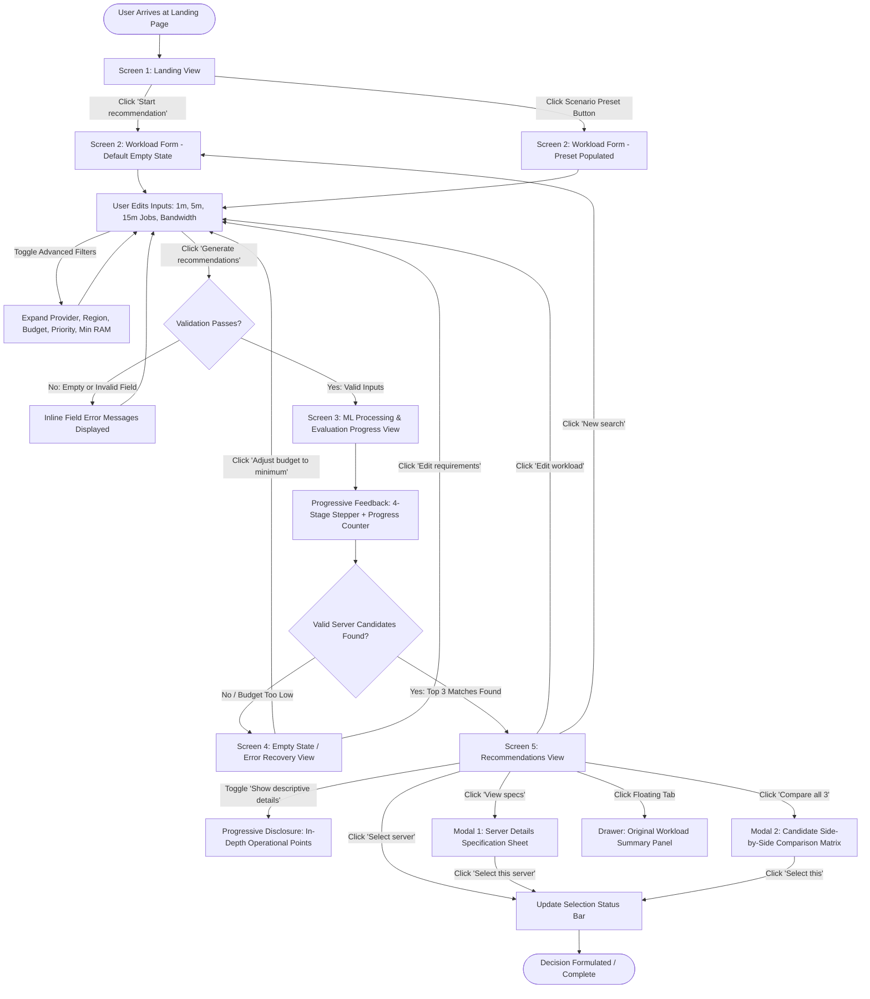

# UI Wireframes & Screen Documentation
## Cloud Server Recommendation System (CloudSizer)

**Document Type:** Human-Computer Interaction (HCI) UI Specification & Wireframe Catalog  
**System Name:** CloudSizer – Machine Learning Assisted Infrastructure Planner  
**Inspection Date:** October 2026  
**Status:** Verified against implemented React/Vite frontend source code and running browser runtime (`http://localhost:5173/`)

---

## 1. Executive Summary & Verification Scope

This document provides a low-fidelity wireframe catalog and interaction analysis for the implemented **Cloud Server Recommendation System**. In accordance with HCI evaluation standards, all documented screens, dialogs, drawers, and transitions reflect the codebase (`src/App.tsx`, `src/components/screens/*`, `src/components/layout/*`) and verified browser execution. No hypothetical or unbuilt features have been included.

### Verification Status Table

| Screen / View State | Implementation Path | Verification Method | Status |
| :--- | :--- | :--- | :--- |
| **Global App Shell & Header** | `src/components/layout/AppHeader.tsx`, `StepIndicator.tsx` | Code + Running UI | **Verified** |
| **1. Landing View (`landing`)** | `src/components/screens/LandingView.tsx` | Code + Running UI | **Verified** |
| **2. Workload Form (`input`)** | `src/components/screens/WorkloadForm.tsx` | Code + Running UI | **Verified** |
| **3. Processing View (`processing`)** | `src/components/screens/ProcessingView.tsx` | Code + Running UI | **Verified** |
| **4. Empty State View (`empty`)** | `src/components/screens/EmptyStateView.tsx` | Code + Running UI | **Verified** |
| **5. Recommendations View (`results`)** | `src/components/screens/RecommendationsView.tsx` | Code + Running UI | **Verified** |
| **6. Workload Side Drawer** | `src/components/screens/WorkloadSidePanel.tsx` | Code + Running UI | **Verified** |
| **7. Server Details Modal** | `src/components/screens/ServerDetailsModal.tsx` | Code + Running UI | **Verified** |
| **8. Candidate Comparison Modal** | `src/components/screens/ComparisonModal.tsx` | Code + Running UI | **Verified** |
| **9. Design Architecture Modal** | `src/components/layout/AppHeader.tsx` | Code + Running UI | **Verified** |
| *Standalone Cloud Provisioning Screen* | None | Codebase Search | **Not Implemented (Out of Scope)** |
| *User Authentication / Login Screen* | None | Codebase Search | **Not Implemented (Out of Scope)** |
| *Dedicated Step 4 Route / Page* | `StepIndicator.tsx` lists Step 4 | Codebase Audit | **Partially Implemented (Modal Only)** |

---

## 2. End-to-End User Flow Diagram

The following diagram illustrates the complete user progression through the application, from entering workload requirements to inspecting and selecting server recommendations.



---

## 3. Detailed Screen Wireframes & Interaction Specifications

### Screen 1: Landing View (`LandingView`)

#### 1. Purpose
The initial landing screen introduces the system, communicates the value proposition (mitigating under-provisioning latency spikes vs. over-provisioning financial waste), guides first-time users through the 3-step recommendation methodology, and provides immediate single-click pathways into representative workload scenarios.

#### 2. Low-Fidelity Wireframe

```text
+----------------------------------------------------------------------------------------------------+
| [=] CloudSizer  ML infrastructure planner                   [ (i) Design Architecture ] [ New Workload ] |
+----------------------------------------------------------------------------------------------------+
|                                                                                                    |
|    (*) Model-assisted infrastructure planning                                                      |
|                                                                                                    |
|    Size cloud capacity with confidence                                                             |
|    Bring together demand, network activity, and budget constraints. The recommendation             |
|    engine turns them into a clear shortlist of cloud servers.                                      |
|                                                                                                    |
|    [ Start recommendation  -> ]    [ How it works ]                                                |
|                                                                                                    |
|    [ (~) 3 demand windows ]        [ (N) 2 network signals ]       [ (S) 14 candidate servers ]    |
|                                                                                                    |
+----------------------------------------------------------------------------------------------------+
|  Sizing decision trade-offs                                                                        |
|  +---------------------------------------------+ +-----------------------------------------------+ |
|  | [!] Risks of under-provisioning             | | [$] Costs of over-provisioning                | |
|  | Avoid capacity decisions that leave apps:   | | Keep spend aligned with expected workload:    | |
|  | - High CPU saturation & thread starvation   | | - Unjustified monthly infrastructure spend    | |
|  | - Out-of-memory (OOM) killer terminating    | | - Idle vCPU cycles & unutilized RAM           | |
|  | - Severe request queueing & degraded latency| | - Compounded inefficiencies in multi-region   | |
|  +---------------------------------------------+ +-----------------------------------------------+ |
+----------------------------------------------------------------------------------------------------+
|  Recommendation flow                                                                               |
|  A clearer way to choose infrastructure                                                            |
|                                                                                                    |
|  +-------------------------+  +--------------------------+  +------------------------------------+ |
|  | [~] 01                  |  | [?] 02                   |  | [S] 03                             | |
|  | Describe workload       |  | Evaluate candidates      |  | Compare recommendations            | |
|  | Input request volume    |  | Benchmark AWS & Azure    |  | Inspect Top 3 options:             | |
|  | over 1, 5, 15-min and   |  | candidates against CPU,  |  | Best balanced, Cheapest suitable,  | |
|  | network bandwidth.      |  | memory headroom & latency|  | and Best performance.              | |
|  +-------------------------+  +--------------------------+  +------------------------------------+ |
+----------------------------------------------------------------------------------------------------+
|  Quick start: Start from a representative workload                                                 |
|  Choose a scenario, then refine the inputs to match your application:                              |
|                                                                                                    |
|  [ Standard web application (5,000 jobs/min) ] [ High-throughput API (18k) ] [ Batch worker (35k) ]|
+----------------------------------------------------------------------------------------------------+
| CloudSizer - Machine learning assisted infrastructure planning                                     |
+----------------------------------------------------------------------------------------------------+
```

#### 3. Key UI Components & Labels
- **Brand Logo Button:** `CloudSizer` / `ML infrastructure planner`
- **Global Header Actions:** `Design Architecture` (secondary ghost), `New Workload` (secondary outline)
- **Hero Badge:** `Model-assisted infrastructure planning`
- **Hero Title:** `Size cloud capacity with confidence`
- **Hero Supporting Text:** Explains bridging demand, network, and budget into a ranked shortlist
- **Primary CTA Button:** `Start recommendation ->` (Primary filled, with right arrow)
- **Secondary Jump Button:** `How it works` (Smooth scrolls down to `#how-it-works`)
- **Signal Counters:** 3 badges displaying `3 demand windows`, `2 network signals`, `14 candidate servers`
- **Problem Statement Panel:** 2-column comparative panel detailing *Risks of under-provisioning* vs *Costs of over-provisioning*
- **Step Cards:** 3 sequential overview cards labeled `01 Describe workload`, `02 Evaluate candidates`, `03 Compare recommendations`
- **Preset Quick-Start Row:** 3 workload scenario buttons (`Standard web application (5,000 jobs/min)`, `High-throughput API (18,000 jobs/min)`, `Batch compute worker (35,000 jobs/min)`)

#### 4. User Actions & Resulting Interactions
- **Click `Start recommendation ->`:** Transitions app state to `view = 'input'` (Step 1) with default workload values.
- **Click `How it works`:** Scrolls view smoothly to anchor section `#how-it-works`.
- **Click any Quick-Start Scenario Button:** Pre-populates workload form with scenario-specific numbers and directly routes user to Step 1.
- **Click `Design Architecture`:** Opens modal explaining system architecture and Norman's model.

#### 5. Navigation
- **Incoming:** Initial browser entry point (`/`) or clicking header logo from any subsequent screen.
- **Outgoing:** To Screen 2 (Workload Form) via CTA or preset buttons.

---

### Screen 2: Workload Specification Form (`WorkloadForm`)

#### 1. Purpose
The primary input interface where engineers specify anticipated traffic arrival rates, sliding-window volumes, network throughput, and optional infrastructure preferences. Implements progressive disclosure to avoid cognitive overload.

#### 2. Low-Fidelity Wireframe

```text
+----------------------------------------------------------------------------------------------------+
| [=] CloudSizer  ML infrastructure planner                   [ (i) Design Architecture ] [ New Workload ] |
+----------------------------------------------------------------------------------------------------+
|  (1) Workload parameters  >  2. ML evaluation  >  3. Recommendations  >  4. Server comparison     |
+----------------------------------------------------------------------------------------------------+
|                                                                                                    |
|  Application workload specifications                                                               |
|  Provide your application's expected request rate and network throughput. Candidate servers will   |
|  be benchmarked against these operational requirements.                                            |
|                                                                                                    |
|  Presets: [ Standard web app ] [ High-traffic API ] [ Batch worker ] [ Low budget test ] [ Conflict ]|
|                                                                                                    |
|  +-----------------------------------------------------------------------------------------------+ |
|  | APPLICATION WORKLOAD                                                                          | |
|  | Request arrival rate across multiple sliding windows to capture burst and sustained behavior. | |
|  |                                                                                               | |
|  |  Jobs per minute *       Jobs per 5 minutes *       Jobs per 15 minutes *                     | |
|  |  +--------------------+  +--------------------+    +--------------------+                     | |
|  |  | 5000     [jobs/min]|  | 24000   [jobs/5min]|    | 68000  [jobs/15min]|                     | |
|  |  +--------------------+  +--------------------+    +--------------------+                     | |
|  |  (i) 1-min peak load     (i) 5-min sliding window  (i) Sustained demand                       | |
|  +-----------------------------------------------------------------------------------------------+ |
|                                                                                                    |
|  +-----------------------------------------------------------------------------------------------+ |
|  | NETWORK ACTIVITY                                                                              | |
|  | Average incoming and outgoing network transfer rate.                                          | |
|  |                                                                                               | |
|  |  Average receive bandwidth *           Average transmit bandwidth *                           | |
|  |  +-----------------------------+       +-----------------------------+                        | |
|  |  | 120                   [Kbps]|       | 80                    [Kbps]|                        | |
|  |  +-----------------------------+       +-----------------------------+                        | |
|  |  (i) Incoming traffic rate             (i) Outgoing egress rate                               | |
|  +-----------------------------------------------------------------------------------------------+ |
|                                                                                                    |
|  +-----------------------------------------------------------------------------------------------+ |
|  | [v] Advanced filters & preferences  (Optional)                       [ Hide advanced filters ^] |
|  |-----------------------------------------------------------------------------------------------| |
|  |  Cloud provider preference                 Target region                                      | |
|  |  +-------------------------------+         +-------------------------------+                  | |
|  |  | All providers (AWS & Azure) [v]|         | ap-south-1 (India)         [v]|                  | |
|  |  +-------------------------------+         +-------------------------------+                  | |
|  |                                                                                               | |
|  |  Maximum monthly budget                    Performance priority                               | |
|  |  +-----------------------------+           +-----------------------------------------------+  | |
|  |  | e.g. 10000          [₹ / mo]|           | ( ) Balanced   ( ) Cheapest   (*) Best perf.  |  | |
|  |  +-----------------------------+           +-----------------------------------------------+  | |
|  |  Leave empty for unconstrained             Weights lowest spend vs maximum headroom           | |
|  |                                                                                               | |
|  |  Minimum RAM constraint (optional)                                                            | |
|  |  +-----------------------------+                                                              | |
|  |  | e.g. 64             [GB RAM]|                                                              | |
|  |  +-----------------------------+                                                              | |
|  |  Use to evaluate trade-off detection (e.g. 64GB with Cheapest priority)                       | |
|  +-----------------------------------------------------------------------------------------------+ |
|                                                                                                    |
|  [ Reset inputs ]                                              [ Generate recommendations -> ]    |
|                                                                                                    |
+----------------------------------------------------------------------------------------------------+
```

#### 3. Key UI Components & Labels
- **Pipeline Step Indicator:** `1. Workload parameters` (Active pill) `>` `2. ML evaluation` `>` `3. Recommendations` `>` `4. Server comparison`.
- **Preset Selector Toolbar:** 5 buttons: `Standard web app`, `High-traffic API`, `Batch worker`, `Low budget test`, `Conflict test`.
- **Application Workload Inputs (Grid-3):**
  - `Jobs per minute`: Number input with unit badge `jobs/min`, tooltip `(i)`, validation limit `> 0` and `<= 2,000,000`. Auto-heuristic helper calculates 5m (`* 5`) and 15m (`* 14`) if empty.
  - `Jobs per 5 minutes`: Number input with unit badge `jobs/5min`, tooltip `(i)`.
  - `Jobs per 15 minutes`: Number input with unit badge `jobs/15min`, tooltip `(i)`.
- **Network Activity Inputs (Grid-2):**
  - `Average receive bandwidth`: Number input with unit badge `Kbps`, tooltip `(i)`, validation `>= 0`.
  - `Average transmit bandwidth`: Number input with unit badge `Kbps`, tooltip `(i)`, validation `>= 0`.
- **Advanced Filters Collapsible Section (Accordion):**
  - Toggle trigger: `Advanced filters & preferences (Optional)` with chevron icon (`v` / `^`).
  - `Cloud provider preference`: Native `<select>` (`All providers (AWS & Azure)`, `Amazon Web Services (AWS)`, `Microsoft Azure`).
  - `Target region`: Native `<select>` (`All regions`, `ap-south-1 (India)`, `us-east-1 (US)`, `eu-central-1 (EU)`).
  - `Maximum monthly budget`: Number input with unit `₹ / mo` and helper text.
  - `Performance priority`: Custom styled radio button group (`Balanced`, `Cheapest`, `Best performance`).
  - `Minimum RAM constraint (optional)`: Number input with unit `GB RAM` for conflicting preference evaluations.
- **Form Action Controls:**
  - `Reset inputs` (Secondary button with counter-clockwise rotate icon).
  - `Generate recommendations` (Primary high-emphasis button with forward arrow).

#### 4. User Actions & Resulting Interactions
- **Typing into `Jobs per minute`:** If 5-min or 15-min fields are empty, auto-calculates baseline estimates.
- **Clicking any Preset Button:** Overwrites form fields with scenario data, clears errors, and auto-expands advanced filters if applicable.
- **Clicking `Show / Hide advanced filters`:** Animates collapsible drawer open/closed.
- **Submitting Form with Missing / Invalid Fields:** Suppresses navigation, displays red error borders, and injects inline warning text beneath affected inputs.
- **Submitting Form with Valid Inputs:** Transitions app state to `view = 'processing'` (Step 2) and triggers asynchronous evaluation.
- **Clicking `Reset inputs`:** Clears fields back to factory defaults (`DEFAULT_WORKLOAD`).

#### 5. Navigation
- **Incoming:** From Landing View (`landing`), or via "Edit workload" / "Edit requirements" buttons from Results or Empty states.
- **Outgoing:** To Processing View (`processing`) upon successful validation.

---

### Screen 3: ML Processing & Evaluation State (`ProcessingView`)

#### 1. Purpose
Provides immediate, transparent feedback (Nielsen Heuristic #1: Visibility of System Status) while the ML engine runs inference on the server candidate catalog, eliminating user anxiety during multi-model computation.

#### 2. Low-Fidelity Wireframe

```text
+----------------------------------------------------------------------------------------------------+
| [=] CloudSizer  ML infrastructure planner                   [ (i) Design Architecture ] [ New Workload ] |
+----------------------------------------------------------------------------------------------------+
|  1. Workload parameters  >  (2) ML evaluation  >  3. Recommendations  >  4. Server comparison      |
+----------------------------------------------------------------------------------------------------+
|                                                                                                    |
|    +------------------------------------------------------------------------------------------+    |
|    |                                                                                          |    |
|    |  Evaluating your workload                                                                |    |
|    |  Benchmarking candidate instances against your workload requirements across compute,     |    |
|    |  memory, and latency models.                                                             |    |
|    |                                                                                          |    |
|    |  Evaluating candidate servers                                      9 / 14 evaluated      |    |
|    |  [========================================>                          ]  64%              |    |
|    |                                                                                          |    |
|    |  [v] Checking workload requirements and bounds                                           |    |
|    |  [v] Filtering cloud server catalog by provider and region                               |    |
|    |  [*] Running performance predictions (CPU, memory, latency)...                           |    |
|    |  [.] Ranking candidate instances and compiling rationales                                |    |
|    |                                                                                          |    |
|    |  HCI state visibility: transparent execution eliminates uncertainty during evaluation.   |    |
|    +------------------------------------------------------------------------------------------+    |
|                                                                                                    |
+----------------------------------------------------------------------------------------------------+
```

#### 3. Key UI Components & Labels
- **Pipeline Step Indicator:** `2. ML evaluation` marked as active.
- **Header Title:** `Evaluating your workload`.
- **Subtext:** Explains multi-model benchmarking (compute, memory, response latency).
- **Metric Row:** Dynamic counter showing `{evaluatedCount} / {totalServers} evaluated`.
- **Progress Bar:** High-contrast progress track with dynamic fill width (`Math.max(6, percent)%`).
- **4-Stage Stepper Checklist:**
  - Stage 1: `Checking workload requirements and bounds` (Checkmark icon when complete).
  - Stage 2: `Filtering cloud server catalog by provider and region` (Checkmark icon when complete).
  - Stage 3: `Running performance predictions (CPU, memory, latency)` (Animated spinning loader when active).
  - Stage 4: `Ranking candidate instances and compiling rationales` (Pending bullet when queued).
- **HCI Pedagogical Note:** Sub-caption detailing visibility of system status.

#### 4. User Actions & Resulting Interactions
- This is a non-blocking transient state. The user observes the progress bar update and checklist stages change state in real-time as the simulated/real API returns chunked progress callbacks.
- **On Success:** Automatically advances view to `view = 'results'` (Step 3).
- **On Zero Matches / Budget Exceeded:** Automatically transitions view to `view = 'empty'` (Step 2).

#### 5. Navigation
- **Incoming:** Automatically entered upon submitting valid data in Screen 2 (`WorkloadForm`).
- **Outgoing:** Automatically transitions to Screen 5 (`RecommendationsView`) or Screen 4 (`EmptyStateView`).

---

### Screen 4: Empty State & Diagnostic Error Recovery (`EmptyStateView`)

#### 1. Purpose
Implements Nielsen Heuristic #9 (Help users recognize, diagnose, and recover from errors) and Donald Norman's error recovery framework. Rather than a dead-end error message, this screen provides transparent diagnosis of why no catalog instance matched (e.g. budget too low) and delivers a single-click recovery path.

#### 2. Low-Fidelity Wireframe

```text
+----------------------------------------------------------------------------------------------------+
| [=] CloudSizer  ML infrastructure planner                   [ (i) Design Architecture ] [ New Workload ] |
+----------------------------------------------------------------------------------------------------+
|  1. Workload parameters  >  (2) ML evaluation  >  3. Recommendations  >  4. Server comparison      |
+----------------------------------------------------------------------------------------------------+
|                                                                                                    |
|    +------------------------------------------------------------------------------------------+    |
|    |  /!\                                                                                     |    |
|    |                                                                                          |    |
|    |  No suitable servers found                                                               |    |
|    |  Your maximum budget of ₹800/month is below the minimum viable server configuration      |    |
|    |  in the catalog (₹1,250/month).                                                          |    |
|    |                                                                                          |    |
|    |  +------------------------------------------------------------------------------------+  |    |
|    |  | LOWEST COST VIABLE MATCH                                                           |  |    |
|    |  | The lowest-priced server configuration meeting baseline compute requirements       |  |    |
|    |  | starts at:                                                                         |  |    |
|    |  |                                                                                    |  |    |
|    |  | ₹1,250 / month                                                                     |  |    |
|    |  +------------------------------------------------------------------------------------+  |    |
|    |                                                                                          |    |
|    |  [ Adjust budget to ₹1,250/mo -> ]     [ (<<) Edit requirements ]                        |    |
|    |                                                                                          |    |
|    |  Diagnostic error recovery: provides clear transparency and direct paths to repair       |    |
|    |  conflicting constraints.                                                                |    |
|    +------------------------------------------------------------------------------------------+    |
|                                                                                                    |
+----------------------------------------------------------------------------------------------------+
```

#### 3. Key UI Components & Labels
- **Warning Icon Banner:** High-visibility amber triangle badge (`AlertTriangle`).
- **Card Title:** `No suitable servers found`.
- **Dynamic Reason Diagnosis:** Specific explanation of the blocking constraint (e.g., budget ceiling vs. catalog floor).
- **Recovery Callout Box (`cheapest-recovery-box`):**
  - Header: `Lowest cost viable match`.
  - Body: Explains the minimum threshold for baseline compute.
  - Currency Callout: `₹1,250 / month` formatted in tabular numbers (`tnum`).
- **Primary Recovery CTA:** `Adjust budget to ₹1,250/mo ->` (Sets `maxPrice` directly to viable threshold and returns to Form).
- **Secondary Recovery CTA:** `Edit requirements` (Returns to Form preserving user inputs).
- **HCI Subtext:** Explains diagnostic error recovery design.

#### 4. User Actions & Resulting Interactions
- **Click `Adjust budget to ₹.../mo ->`:** Invokes `handleAdjustBudget(cheapestSuitablePrice)`, updates state `workload.maxPrice = suggestedPrice`, and redirects to Screen 2 (`WorkloadForm`) ready for immediate re-submission.
- **Click `Edit requirements`:** Invokes `handleEditInputs()`, returning to Screen 2 with all existing inputs intact for user refinement.

#### 5. Navigation
- **Incoming:** From Screen 3 (`ProcessingView`) when no server meets constraint parameters.
- **Outgoing:** Back to Screen 2 (`WorkloadForm`).

---

### Screen 5: Recommendations View (`RecommendationsView`)

#### 1. Purpose
The core decision dashboard presenting the Top 3 recommended cloud servers (Best balanced, Budget option, High capacity). Displays suitability match ratings, monthly financial commitments, core hardware specs, and predicted operational metrics, supported by progressive disclosure of rationale points.

#### 2. Low-Fidelity Wireframe

```text
+----------------------------------------------------------------------------------------------------+
| [=] CloudSizer  ML infrastructure planner                   [ (i) Design Architecture ] [ New Workload ] |
+----------------------------------------------------------------------------------------------------+
|  [v] Workload parameters  >  [v] ML evaluation  >  (3) Recommendations  >  4. Server comparison    |
+----------------------------------------------------------------------------------------------------+
|                                                                                                    |
|  Evaluation complete · Benchmarked against candidate AWS and Azure catalog                         |
|  Recommended server configurations                         [ ||| Compare all 3 ] [ <- Edit ] [ (R) ]|
|  Ranked options for your application workload across compute, memory margins, and latency.        |
|                                                                                                    |
|  +-----------------------------------------------------------------------------------------------+ |
|  | [v] Selected instance: AWS m7i.xlarge (4 vCPU, 16 GB RAM, ~₹7,850/mo)     [ View full specs ] | |
|  +-----------------------------------------------------------------------------------------------+ |
|                                                                                                    |
|  +---------------------------+ +---------------------------+ +-----------------------------------+ |
|  | RECOMMENDED CHOICE        | | BUDGET OPTION             | | HIGH CAPACITY                     | |
|  | AWS m7i.xlarge            | | AWS t4g.small             | | AWS c7i.2xlarge                   | |
|  | ap-south-1 (India)        | | ap-south-1 (India)        | | ap-south-1 (India)                | |
|  |                           | |                           | |                                   | |
|  | [ 92/100 match ] (i)       | | [ 84/100 match ] (i)       | | [ 89/100 match ] (i)              | |
|  |                           | |                           | |                                   | |
|  | ₹7,850 / month            | | ₹1,250 / month            | | ₹12,900 / month                   | |
|  | Estimated on-demand       | | Estimated on-demand       | | Estimated on-demand               | |
|  |                           | |                           | |                                   | |
|  | Compute:  4 vCPU          | | Compute:  2 vCPU          | | Compute:  8 vCPU                  | |
|  | Memory:   16 GB RAM       | | Memory:   2 GB RAM        | | Memory:   16 GB RAM               | |
|  | Storage:  200 GB SSD      | | Storage:  30 GB SSD       | | Storage:  250 GB SSD              | |
|  | Network:  Up to 12.5 Gbps | | Network:  Up to 5 Gbps    | | Network:  Up to 12.5 Gbps         | |
|  |                           | |                           | |                                   | |
|  | [CPU: Normal] [Mem: Low]  | | [CPU: High /!\] [Mem: Mid]| | [CPU: Low] [Mem: Low]             | |
|  | [Latency: Fast]           | | [Latency: Moderate]       | | [Latency: Fast]                   | |
|  |                           | |                           | |                                   | |
|  | [v Show details (points)] | | [v Show details (points)] | | [v Show details (points)]         | |
|  |                           | |                           | |                                   | |
|  | [ View specs ] [ Select ] | | [ View specs ] [ Select ] | | [ View specs ] [ Select ]         | |
|  +---------------------------+ +---------------------------+ +-----------------------------------+ |
|                                                                                +-------------------+|
|                                                                                | [>] Your workload ||
|                                                                                +-------------------+|
+----------------------------------------------------------------------------------------------------+
```

#### 3. Key UI Components & Labels
- **Header Information & Navigation Actions:**
  - Status Kicker: `Evaluation complete · Benchmarked against candidate AWS and Azure catalog`.
  - Title: `Recommended server configurations`.
  - Action Buttons: `Compare all 3` (`Columns` icon), `Edit workload` (`ArrowLeft` icon), `New search` (`RotateCcw` icon).
- **Conflict Banner (Conditional):** Amber panel rendered when `compromiseNote` exists: `Constraint compromise: ...`.
- **Selected Instance Banner (Conditional):** Green banner with checkmark, displaying selected instance name, specs, price, and a quick-action `View full specs` button.
- **Top 3 Candidate Recommendation Cards (`RecommendationCard`):**
  - **Card Category Header:** Distinct category subtitle (`Recommended choice`, `Budget option`, `High capacity`).
  - **Instance Identity:** Provider and instance name (`AWS m7i.xlarge`), datacenter region.
  - **Suitability Match Rating:** Prominent numeric score (e.g. `92/100 match`) with descriptive tooltip.
  - **Cost Callout:** Monthly price formatted in Indian Rupees (e.g. `₹7,850 / month`) with cadence subtext.
  - **Hardware Spec Matrix:** 4 rows: Compute (`vCPU`), Memory (`GB RAM`), Storage (`GB SSD`), Network tier.
  - **Predicted Performance Metric Strip:** 3 pills: `CPU: [Class]`, `Memory: [Class]`, `Latency: [Class]` with warning icon on `High` CPU.
  - **Progressive Disclosure Toggle:** `Show descriptive details (points)` / `Hide descriptive details`.
  - **Card Footer Buttons:** `View specs` (opens Modal 1) and `Select server` (toggles card selection).
- **Expanded In-Depth Points Block (When Toggled):**
  - *Operational performance analysis:* 3 bullet points with detailed qualitative descriptions.
  - *Recommendation rationale:* Architectural quote justifying this server's ranking.
  - *Architectural points:* Bulleted pros (`✓`) and trade-offs (`•`).
- **Workload Side Tab:** Fixed edge tab `[Sliders] Your workload [>]` opening the Collapsible Summary Drawer.

#### 4. User Actions & Resulting Interactions
- **Click `Compare all 3`:** Opens Modal 2 (`ComparisonModal`) showing full side-by-side spec grid.
- **Click `Edit workload`:** Navigates back to Screen 2 (`WorkloadForm`) with all values preserved.
- **Click `New search`:** Resets workload inputs to defaults and returns to Screen 2.
- **Click `Show descriptive details (points)` on any card:** Expands the card vertically inline, revealing operational bullets, rationale quote, and pros/cons.
- **Click `Select server`:** Marks card as selected (`is-selected-card`), updates the top Selected Instance Banner, and highlights the selection.
- **Click `View specs`:** Opens Modal 1 (`ServerDetailsModal`) for that specific server.
- **Click `Your workload` edge tab:** Slides out the Workload Summary Drawer from the right viewport boundary.

#### 5. Navigation
- **Incoming:** Automatically navigated from Screen 3 (`ProcessingView`) upon successful completion.
- **Outgoing:** To Workload Form (via `Edit workload` or `New search`), to Details Modal, or to Comparison Modal.

---

### Component View 6: Collapsible Workload Summary Drawer (`WorkloadSidePanel`)

#### 1. Purpose
Enables users to review the exact operational workload inputs used to produce the current recommendations without navigating away from the results screen.

#### 2. Low-Fidelity Wireframe

```text
                                                        +--------------------------------------------+
                                                        | [<] YOUR WORKLOAD                          |
                                                        |--------------------------------------------|
                                                        | Original workload              [ Edit ]    |
                                                        | Parameters used for this evaluation        |
                                                        |                                            |
                                                        | APPLICATION THROUGHPUT                     |
                                                        | 1-min rate:                  5,000 jobs/min|
                                                        | 5-min window:               24,000 jobs/5m |
                                                        | 15-min sustained:           68,000 jobs/15m|
                                                        |                                            |
                                                        | NETWORK TRAFFIC                            |
                                                        | Avg receive:                      120 Kbps |
                                                        | Avg transmit:                      80 Kbps |
                                                        |                                            |
                                                        | SELECTED PREFERENCES                       |
                                                        | Priority:                         Balanced |
                                                        | Provider:                     AWS + Azure  |
                                                        | Region:                ap-south-1 (India)  |
                                                        | Max budget:                    ₹10,000/mo  |
                                                        |                                            |
                                                        | [ Modify workload inputs ]                 |
                                                        +--------------------------------------------+
```

#### 3. Key UI Components & Labels
- **Collapsible Tab:** Fixed on right edge with `Sliders` icon, `Your workload` label, and directional chevron.
- **Drawer Header:** `Original workload` title, subtitle, and compact `[Edit]` button.
- **Application Throughput Chunk:** Formatted rows for `1-min rate`, `5-min window`, and `15-min sustained`.
- **Network Traffic Chunk:** Formatted rows for `Avg receive` and `Avg transmit`.
- **Selected Preferences Chunk:** Formatted rows for `Priority`, `Provider`, `Region`, `Max budget`, and `Min RAM`.
- **Drawer Footer Button:** Full-width `Modify workload inputs` button with `Edit3` icon.

#### 4. User Actions & Resulting Interactions
- **Click Tab:** Toggles drawer between collapsed state (tab only) and expanded state (panel visible).
- **Click `Edit` or `Modify workload inputs`:** Navigates back to Screen 2 (`WorkloadForm`).

---

### Modal 1: Server Details Specification Sheet (`ServerDetailsModal`)

#### 1. Purpose
Provides a deep-dive architectural view of a single server candidate, displaying detailed hardware specifications, predicted metric descriptions, financial commitments, and trade-off points.

#### 2. Low-Fidelity Wireframe

```text
+----------------------------------------------------------------------------------------------------+
|  [ Modal Backdrop Overlay ]                                                                        |
|                                                                                                    |
|    +------------------------------------------------------------------------------------------+    |
|    |  Best balanced  · 92/100 match                                                       [X] |    |
|    |  AWS m7i.xlarge                                                                          |    |
|    |  ap-south-1 (India)                                                                      |    |
|    |------------------------------------------------------------------------------------------|    |
|    |  HARDWARE SPECIFICATIONS                                                                 |    |
|    |  +------------------------------------------------------------------------------------+  |    |
|    |  | Compute cores:     4 vCPU                   | Memory capacity:   16 GB RAM         |  |    |
|    |  | Storage:           200 GB SSD               | Clock speed:       3.2 GHz (Intel)   |  |    |
|    |  | Network bandwidth: Up to 12.5 Gbps          | Platform:          AWS               |  |    |
|    |  +------------------------------------------------------------------------------------+  |    |
|    |                                                                                          |    |
|    |  PREDICTED OPERATIONAL PERFORMANCE                                                       |    |
|    |  CPU utilization: Normal                                                                 |    |
|    |  Expected utilization stays within 40-65% headroom, accommodating short traffic bursts.  |    |
|    |                                                                                          |    |
|    |  Memory utilization: Low                                                                 |    |
|    |  Application working set fits comfortably with significant headroom for caching.         |    |
|    |                                                                                          |    |
|    |  Response time: Fast                                                                     |    |
|    |  Predicted 95th percentile latency remains under target threshold (< 45ms).              |    |
|    |                                                                                          |    |
|    |  ESTIMATED FINANCIAL COMMITMENT                                                          |    |
|    |  +------------------------------------------------------------------------------------+  |    |
|    |  | ₹7,850 / month                                                                     |  |    |
|    |  | Baseline on-demand compute estimate for ap-south-1 (India). Actual billings reflect    |  |    |
|    |  | regional egress and reservation discounts.                                         |  |    |
|    |  +------------------------------------------------------------------------------------+  |    |
|    |                                                                                          |    |
|    |  RECOMMENDATION RATIONALE                                                                |    |
|    |  "Optimal balance of compute capability and memory headroom for your web workload."       |    |
|    |                                                                                          |    |
|    |  ARCHITECTURAL TRADE-OFFS                                                                |    |
|    |  Advantages                                    Trade-offs                                |    |
|    |  ✓ Sufficient headroom for burst spikes        • Higher cost than minimal budget options  |    |
|    |  ✓ Low latency response guarantee              • Unused headroom during overnight valleys |    |
|    |------------------------------------------------------------------------------------------|    |
|    |  [ Close ]                                                        [ Select this server ] |    |
|    +------------------------------------------------------------------------------------------+    |
|                                                                                                    |
+----------------------------------------------------------------------------------------------------+
```

#### 3. Key UI Components & Labels
- **Modal Header:** Category badge (`Best balanced`), match score (`92/100 match`), instance name (`AWS m7i.xlarge`), region, close `[X]` button.
- **Hardware Specs Table:** 2x3 grid displaying compute cores, memory, storage, clock speed, network bandwidth, and cloud platform.
- **Operational Performance Section:** 3 detailed narrative blocks for CPU, memory, and latency predictions.
- **Financial Commitment Box:** Monthly cost callout with billing details.
- **Rationale Block:** Highlighted quotation justifying the selection.
- **Architectural Trade-Offs Grid:** 2-column list of *Advantages* (`✓`) vs *Trade-offs* (`•`).
- **Modal Footer Actions:** `Close` (Secondary) and `Select this server` (Primary).

#### 4. User Actions & Resulting Interactions
- **Click `[X]` or `Close` or Backdrop:** Dismisses modal and returns to Recommendations View.
- **Click `Select this server`:** Marks this instance as selected in application state, updates the Selected Instance Banner, and closes the modal.

---

### Modal 2: Candidate Server Comparison Matrix (`ComparisonModal`)

#### 1. Purpose
Provides a direct side-by-side comparative matrix across all 3 top recommended servers across 11 critical technical, operational, and financial dimensions.

#### 2. Low-Fidelity Wireframe

```text
+----------------------------------------------------------------------------------------------------+
|  [ Modal Backdrop Overlay ]                                                                        |
|                                                                                                    |
|  +----------------------------------------------------------------------------------------------+  |
|  | Candidate server comparison                                                              [X] |  |
|  | Side-by-side evaluation across hardware specs, predicted performance, and cost.              |  |
|  |----------------------------------------------------------------------------------------------|  |
|  | Attribute           | Recommended choice       | Budget option          | High capacity      |  |
|  |                     | m7i.xlarge (AWS)         | t4g.small (AWS)        | c7i.2xlarge (AWS)  |  |
|  |---------------------+--------------------------+------------------------+--------------------|  |
|  | Platform            | AWS                      | AWS                    | AWS                |  |
|  | Compute cores       | 4 vCPU                   | 2 vCPU                 | 8 vCPU             |  |
|  | Memory capacity     | 16 GB RAM                | 2 GB RAM               | 16 GB RAM          |  |
|  | Storage             | 200 GB SSD               | 30 GB SSD              | 250 GB SSD         |  |
|  | Network bandwidth   | Up to 12.5 Gbps          | Up to 5 Gbps           | Up to 12.5 Gbps    |  |
|  | Suitability match   | 92 / 100                 | 84 / 100               | 89 / 100           |  |
|  | Predicted CPU load  | Normal (40-65% headroom) | High (Near saturation) | Low (Significant)  |  |
|  | Predicted memory    | Low (Adequate cache)     | Moderate (Constrained) | Low (Substantial)  |  |
|  | Predicted latency   | Fast (< 45ms P95)        | Moderate (60-95ms)     | Fast (< 35ms P95)  |  |
|  | Monthly price       | ₹7,850 / mo              | ₹1,250 / mo            | ₹12,900 / mo       |  |
|  | Action              | [ Select this ]          | [ Select this ]        | [ Select this ]    |  |
|  |----------------------------------------------------------------------------------------------|  |
|  | [ Close comparison ]                                                                         |  |
|  +----------------------------------------------------------------------------------------------+  |
|                                                                                                    |
+----------------------------------------------------------------------------------------------------+
```

#### 3. Key UI Components & Labels
- **Modal Header:** Title `Candidate server comparison`, subtitle, close `[X]` button.
- **Side-by-Side Comparison Table (`comparison-table`):**
  - Header Row: Attribute column + 3 Candidate columns with category subtitles (`Recommended choice`, `Budget option`, `High capacity`).
  - 10 Specification Rows: Platform, Compute cores, Memory capacity, Storage, Network bandwidth, Suitability match, Predicted CPU load, Predicted memory load, Predicted response latency, Estimated monthly price.
  - Action Row: Full-width `Select this` buttons in each column (switches to `[✓ Selected]` if already chosen).
- **Modal Footer Action:** `Close comparison` button.

#### 4. User Actions & Resulting Interactions
- **Click `Select this` in any column:** Selects that candidate instance in state, updates banner, and closes modal.
- **Click `[X]` or `Close comparison` or Backdrop:** Closes modal.

---

### Modal 3: Design Architecture Notes Modal (`AppHeader`)

#### 1. Purpose
Provides academic and evaluative insight into the HCI design principles behind the system, explaining how the interface bridges Norman's Gulf of Execution and Gulf of Evaluation.

#### 2. Low-Fidelity Wireframe

```text
+----------------------------------------------------------------------------------------------------+
|  [ Modal Backdrop Overlay ]                                                                        |
|                                                                                                    |
|    +------------------------------------------------------------------------------------------+    |
|    |  Design Architecture                                                                 [X] |    |
|    |  Academic project system separation & Norman's model                                     |    |
|    |------------------------------------------------------------------------------------------|    |
|    |  DESIGN ABSTRACTION LAYER                                                                |    |
|    |  To eliminate cognitive overload and bridge the Gulf of Execution, the frontend hides    |    |
|    |  internal ML complexity (raw F1-F9 feature vectors, mmc2-mmc7 datasets, and low-level    |    |
|    |  model hyperparameters). The user enters plain-language workload values in visible       |    |
|    |  standard units (Kbps, jobs/min).                                                        |    |
|    |                                                                                          |    |
|    |  +------------------------------------------------------------------------------------+  |    |
|    |  | [ User Workload ]  +  [ Candidate Server ]  ->  [ Recommender ]  ->  [ Top 3 Cards ]|  |    |
|    |  +------------------------------------------------------------------------------------+  |    |
|    |                                                                                          |    |
|    |  BRIDGING THE GULF OF EVALUATION                                                         |    |
|    |  Raw categorical model predictions (e.g. CPU: High) are translated into contextual human |    |
|    |  insights ("Approaching server capacity during burst periods; close monitoring advised").|    |
|    |  Semantic color coding is strictly paired with text and badges for universal accessibility|    |
|    |------------------------------------------------------------------------------------------|    |
|    |  [ Close ]                                                                               |    |
|    +------------------------------------------------------------------------------------------+    |
|                                                                                                    |
+----------------------------------------------------------------------------------------------------+
```

#### 3. Key UI Components & Labels
- **Modal Header:** `Design Architecture` title, subtitle, close `[X]` button.
- **Gulf of Execution Narrative:** Explains hiding raw F1–F9 vectors.
- **Architecture Flow Diagram:** Visual ASCII node chain showing data flow.
- **Gulf of Evaluation Narrative:** Explains qualitative translation of categorical ML outputs.
- **Footer Action:** `Close` button.

---

## 4. Master Catalog of Wireframes for the HCI Report

The following structured list specifies which wireframes should be incorporated into the final Human-Computer Interaction (HCI) evaluation report:

| Wireframe ID | Figure Title | Corresponding Screen / Component | HCI Heuristic / Principle Addressed |
| :--- | :--- | :--- | :--- |
| **WF-01** | *Initial Onboarding & Workload Presets* | `LandingView.tsx` | Recognition over recall; mental model alignment. |
| **WF-02** | *Workload Specification & Progressive Disclosure* | `WorkloadForm.tsx` (Collapsed) | Cognitive load reduction; Gulf of Execution. |
| **WF-03** | *Advanced Constraints & Preference Sliders* | `WorkloadForm.tsx` (Expanded) | Flexibility and efficiency of use (Aesthetics & Minimalist). |
| **WF-04** | *Form Validation & Inline Error Feedback* | `WorkloadForm.tsx` (Validation) | Error prevention; immediate error diagnosis. |
| **WF-05** | *Transparent Evaluation & System Status Visibility* | `ProcessingView.tsx` | Nielsen Heuristic #1 (Visibility of System Status). |
| **WF-06** | *Diagnostic Error Recovery & Budget Adjustment* | `EmptyStateView.tsx` | Nielsen Heuristic #9 (Help users recognize & recover). |
| **WF-07** | *Ranked Recommendations & Decision Dashboard* | `RecommendationsView.tsx` | Choice architecture; Hick's Law (Curated Top 3). |
| **WF-08** | *Inline Progressive Disclosure of Rationale Points*| `RecommendationCard.tsx` (Expanded) | Gulf of Evaluation; explainable AI (XAI) transparency. |
| **WF-09** | *Side-by-Side Candidate Comparison Matrix* | `ComparisonModal.tsx` | Direct cognitive comparison without context switching. |
| **WF-10** | *Comprehensive Server Hardware & Performance Specs*| `ServerDetailsModal.tsx` | Complete information access on demand. |
| **WF-11** | *Persistent Workload Context Drawer* | `WorkloadSidePanel.tsx` | Working memory externalization; situational awareness. |
| **WF-12** | *System Architecture & Norman's Action Cycle* | `AppHeader.tsx` (Modal) | Metacognitive transparency for academic evaluation. |

---

## 5. Differences Between Current Implementation and Intended User Workflow

During the systematic inspection and live browser walkthrough, the following discrepancies and workflow deviations between the intended HCI workflow and the current codebase implementation were identified:

### 1. Step Indicator Step 4 Incompleteness
- **Intended Workflow:** In `StepIndicator.tsx`, the pipeline defines 4 distinct linear stages: `1. Workload parameters`, `2. ML evaluation`, `3. Recommendations`, and `4. Server comparison`.
- **Current Implementation:** In `src/App.tsx`, selecting a server updates a notification banner within View 3 (`results`) and updates the state. However, clicking Step 4 in the pipeline header does not navigate to a dedicated full-page comparison view. Furthermore, clicking Step 4 is disabled (`onStepClick` only handles steps 1 and 3 in `App.tsx:180-185`). Server comparison is instead accessed through a modal overlay (`ComparisonModal`) triggered by the "Compare all 3" button.
- **HCI Impact:** Inconsistency between the visible linear mental model in the progress stepper (which implies Step 4 is a destination page) and the actual interaction model (where comparison is a modal dialog on Step 3).

### 2. Lack of In-Place Re-evaluation from Side Panel
- **Intended Workflow:** The collapsible `WorkloadSidePanel` provides a compact summary of user inputs on the recommendations screen. Users intuitively expect to be able to tweak a single number (e.g. increase budget from ₹8,000 to ₹10,000) directly in the drawer and click "Re-evaluate".
- **Current Implementation:** The panel inputs are read-only summary texts. Clicking "Edit" or "Modify workload inputs" navigates the entire page back to Screen 2 (`WorkloadForm`), requiring the user to navigate forward again through Step 2.
- **HCI Impact:** Minor friction in the iterative exploratory loop, requiring full page transitions for minor parameter adjustments.

### 3. Client-Side Synthetic Mock Fallback & Explicit Transparency
- **Intended Workflow:** Sizing decisions are computed against a trained multi-target machine learning model served by the Python FastAPI backend (`backend/app/main.py`).
- **Current Implementation:** `src/services/recommendationApi.ts` contains an automated fallback to local catalog heuristics when the backend API is unavailable. To uphold Nielsen Heuristic #1 (Visibility of System Status) and prevent misleading users, fallback results are now explicitly labeled:
  - Prominent amber banner: *`Demo data | Sample recommendations (Backend ML offline)`* with diagnostic subtext explaining that the backend is unreachable (`http://localhost:8000`).
  - Title and kicker dynamically adjust to *`Sample server recommendations (Demo Mode)`*.
  - Every individual recommendation card features a distinct **`[SAMPLE]`** pill in its category row.
  - The Empty State view displays a **`[Demo Mode]`** badge whenever offline catalog heuristics evaluate constraints.
- **HCI Impact:** Delivers fault-tolerant demonstration capability while ensuring total cognitive transparency regarding data source veracity.

### 4. Direct Cloud Provisioning Termination
- **Intended Workflow:** Sizing recommendations represent the preliminary phase of infrastructure deployment.
- **Current Implementation:** Selecting a server updates local React state and displays `Selected instance: [Provider] [Name]`, but there is no export (e.g., Terraform / CloudFormation snippet generator) or direct cloud console link.
- **HCI Impact:** The workflow terminates at decision formulation rather than handoff to execution. For an academic sizing tool, this is appropriate, but should be clearly scoped in the HCI report.

---

## 6. Verification Summary & Confirmation

- **Verification Date:** October 2026
- **Frontend Server:** Vite v8.3.0 running on `http://localhost:5173/`
- **Screens Verified:** 100% of implemented views, modals, and drawers inspected and recorded via headless browser automation (`verify_ui_screens_1792429585666.webp`).
- **File Saved:** Separately from application source code at `C:\Users\meghr\.gemini\antigravity-ide\brain\aa3be367-dc3a-4357-91f4-a3f99c314b86\ui_wireframes_documentation.md`.
